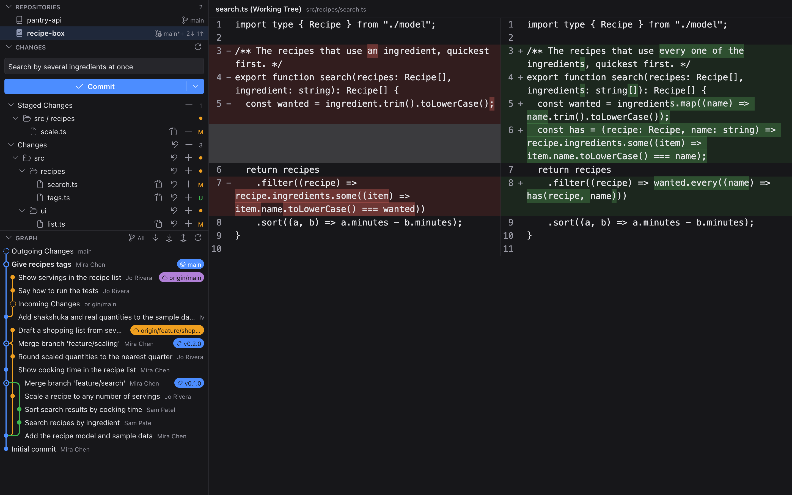

# Source Control for Paseo

VS Code-style Source Control for [Paseo](https://paseo.sh).



What each part of it does is in [docs/features.md](docs/features.md).

## Requirements

- Paseo 0.14.0 or later, with plugins enabled
- `git` on the daemon's `PATH`

## Install from a checkout

```bash
git clone https://github.com/KosmoCHE/paseo-source-control.git
cd paseo-source-control
npm install
paseo plugin install "$(pwd)"
```

Open a workspace: **Source Control** is available as an explorer tab and as a workspace tab.

## Which repositories are listed

The same ones VS Code's git extension opens for the folder: the repository at the workspace's folder itself, and those in its subfolders, one level down by default. A repository whose root lies above the folder is not listed; when the folder has no repository of its own, the panel offers to open that one.

These settings are read from the folder's `.vscode/settings.json`, with VS Code's meaning and defaults:

| Setting | Default |
| --- | --- |
| `git.autoRepositoryDetection` | `true` |
| `git.repositoryScanMaxDepth` | `1` |
| `git.repositoryScanIgnoredFolders` | `["node_modules"]` |
| `git.scanRepositories` | `[]` |
| `git.ignoredRepositories` | `[]` |
| `git.openRepositoryInParentFolders` | `"prompt"` |

VS Code's user-level settings are not read, and submodules and worktrees are not added on their own.

## Limits

- The graph draws at most ten lanes side by side; lanes further right are cut off.
- Diffs have no syntax colours.
- Open File is offered on the desktop and in a browser only. A plugin has no call yet to open a file in Paseo's file tab, so the panel presses a hidden Markdown link to the file instead, which needs a web page ([issue #1](https://github.com/KosmoCHE/paseo-source-control/issues/1)).
- Fetch, pull, push and the fetch every three minutes run with the daemon's git credentials and cannot answer a password prompt.
- Switching and creating branches is left to the agents: the panel has no such actions.

## Development

See [docs/development.md](docs/development.md).

## Credits and licence

The plugin is under the MIT License, in [LICENSE](LICENSE), except for its icons.

- The panel's icons are VS Code's codicons, © Microsoft Corporation, from [vscode-codicons](https://github.com/microsoft/vscode-codicons), under [CC BY 4.0](https://creativecommons.org/licenses/by/4.0/). Only each icon's SVG paths are kept, in an inline SVG whose colour Paseo sets. `client/codicons.ts`, which holds them, is not covered by the MIT License. The icons of the two tabs, which sit among Paseo's own, are Lucide's.
- Parts of `server/git.ts`, `server/repositories.ts`, `client/ago.ts`, `client/unchanged.ts` and `client/overview.ts` are adapted from [VS Code](https://github.com/microsoft/vscode) 1.142.0, Copyright (c) Microsoft Corporation, under the [MIT License](https://github.com/microsoft/vscode/blob/1.142.0/LICENSE.txt). Each file names what it took.
